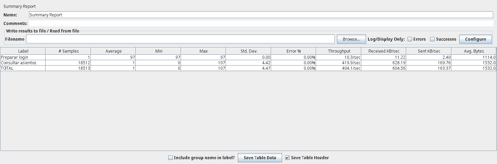
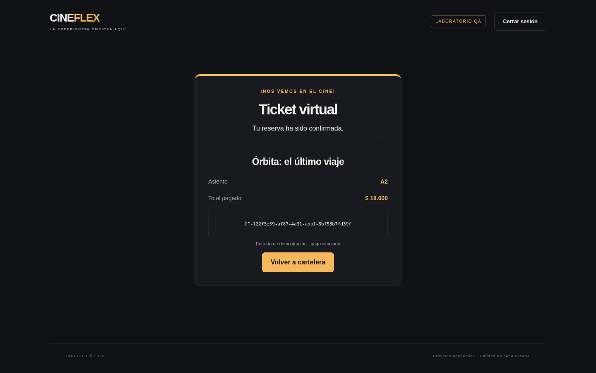

# CineFlex · Taller práctico integrador de QA

## Video de sustentación

## Descripción

Plataforma académica de reserva de entradas con API Express, interfaz web, SQLite y pasarela de pagos simulada. Incluye pruebas de backend, colección Postman, 20 casos Selenium con POM, plan JMeter y pipeline de GitHub Actions.

La [estrategia de pruebas](estrategia_pruebas.pdf) documenta la integración Top-Down, el diseño del Stub, los requisitos, la regresión y la comparación de herramientas.

## Ejecutar con Docker

Instala [Docker Desktop](https://docs.docker.com/get-started/get-docker/) en Windows/macOS, o [Docker Engine](https://docs.docker.com/engine/install/) con el [plugin Compose](https://docs.docker.com/compose/install/linux/) en Linux. Docker debe estar iniciado. No necesitas instalar Node, npm, SQLite, Chrome, Java ni JMeter en tu equipo.

Desde la carpeta del proyecto, inicia la aplicación con un solo comando:

```bash
docker compose up --build -d --wait
```

Abre [CineFlex](http://localhost:3000). Usuario: `demo@cineflex.test`; contraseña: `CineFlex123!`. Para un pago aprobado usa la tarjeta ficticia `4111111111111111`. Todos los pagos son simulados.

La primera ejecución descarga la imagen base e instala las dependencias dentro del contenedor. Las siguientes reutilizan las capas de construcción. `--wait` espera a que la comprobación de salud confirme que la aplicación responde; requiere Compose v2 con soporte para esa opción.

### Reservas, logs y apagado

Las reservas se guardan en el volumen `cineflex-data` y se conservan al detener o reconstruir la aplicación. El inicio normal no modifica la base de datos que puedas tener fuera de Docker en `backend/data/`. Al reiniciar el proceso tendrás que iniciar sesión otra vez porque la firma de los tokens es temporal.

```bash
docker compose ps
docker compose logs -f app
docker compose down
```

`logs -f` sigue la salida hasta pulsar Ctrl+C. `down` detiene los servicios y conserva los volúmenes. **`docker compose down -v` elimina los volúmenes, incluyendo las reservas y los resultados de pruebas**; úsalo solo si quieres borrar esos datos y comenzar de nuevo.

Si el puerto 3000 está ocupado, cambia el puerto publicado. Linux/macOS:

```bash
CINEFLEX_PORT=3001 docker compose up --build -d --wait
```

PowerShell:

```powershell
$env:CINEFLEX_PORT='3001'
docker compose up --build -d --wait
```

En ese caso abre `http://localhost:3001`.

### Ejecutar todas las pruebas con un comando

```bash
docker compose run --build --rm qa
```

Este servicio instala las herramientas de prueba dentro de su propia imagen y ejecuta, en orden: backend, Postman/Newman, los 20 casos Selenium y JMeter con 500 usuarios. Devuelve un código distinto de cero si falla una suite o los umbrales de rendimiento. La imagen de la aplicación no incluye estas herramientas.

No necesitas iniciar `app` antes: cada suite levanta un servidor interno con puerto libre y una base de datos temporal. Las pruebas no alteran las reservas de la aplicación. El servicio `qa` tiene un perfil separado, por lo que no se ejecuta con el comando normal de arranque. La primera construcción requiere internet y tarda más porque descarga Chromium, Java y JMeter. Reserva al menos 2 GB de memoria para Docker al ejecutar la carga; las métricas dependen de los recursos asignados al contenedor.

También puedes elegir una suite:

```bash
docker compose run --build --rm qa npm test
docker compose run --build --rm qa npm run test:api
docker compose run --build --rm qa npm run test:ui
docker compose run --build --rm qa npm run test:performance
```

Los informes y capturas se guardan en `qa-artifacts`; los JTL y dashboards de JMeter, en `qa-performance`. Para copiarlos al equipo después de las pruebas:

```bash
docker compose create qa
docker compose cp qa:/app/artifacts/. ./artifacts
docker compose cp qa:/app/performance/results/. ./performance/results
docker compose rm -f qa
```

### Configuración y comprobación

- `Dockerfile` define las imágenes `runtime` y `qa`. Ambas ejecutan los procesos con un usuario sin privilegios.
- `compose.yaml` configura el puerto local, los volúmenes y los servicios.
- `.dockerignore` excluye secretos locales, dependencias del equipo y resultados anteriores del contexto de construcción.

Puedes revisar la configuración con `docker compose config` y comprobar el arranque con `docker compose ps`. La construcción y ejecución en Docker están pendientes de validación en un equipo con Docker disponible.

## Inicio rápido

Necesitas **Node.js 24 o superior** y npm. La interfaz y la API se sirven juntas; no necesitas MongoDB, Cloudinary ni un servidor frontend adicional.

```bash
cd qa-cineflex-project
npm ci
npm start
```

Abre **http://127.0.0.1:3000**. Acceso de demostración:

- Correo: `demo@cineflex.test`
- Contraseña: `CineFlex123!`
- Tarjeta ficticia aprobada: `4111111111111111`
- Tarjeta ficticia rechazada por el banco: `4000000000000002`
- Banco simulado indisponible: `4000000000009995`
- Tarjeta falsa para la prueba negativa: `1234567890123456`

No ingreses tarjetas reales. La sala tiene 24 asientos; A1 de la película 1 inicia ocupado como dato de prueba. Cada película representa una única función. Las ventas locales se guardan en `backend/data/cineflex.sqlite` y sobreviven a reinicios.

`npm run dev` inicia Nodemon. Desde `backend/` también funcionan `npm start` y `npm run dev`.

## Configuración del entorno

La configuración por defecto permite iniciar sin copiar archivos. Para personalizarla, copia `backend/.env.example` a `backend/.env` y ajusta las variables. En Linux/macOS:

```bash
cp backend/.env.example backend/.env
node -e "console.log(require('node:crypto').randomBytes(32).toString('hex'))"
```

Pega el valor generado en `JWT_SECRET`. En Windows puedes copiar el archivo con el explorador o `Copy-Item backend/.env.example backend/.env` desde PowerShell. No publiques tu `.env`.

| Variable | Valor por defecto | Uso |
| --- | --- | --- |
| `PORT` | `3000` | Puerto del servidor |
| `HOST` | `127.0.0.1` | Dirección local de escucha |
| `DB_PATH` | `./data/cineflex.sqlite` | Ruta relativa a backend, o absoluta |
| `JWT_SECRET` | Aleatorio por arranque | Firma; mínimo 32 caracteres si se configura |
| `JWT_EXPIRES_IN` | `1h` | Vencimiento del JWT |
| `LOCK_MS` | `60000` | Bloqueo tras 3 errores; mantener este valor para el taller |

Sin secreto fijo, reiniciar el servidor invalida tokens anteriores. Las suites usan una base en memoria y un puerto libre, sin tocar la base local ni necesitar `npm start` por separado. Para reiniciar solo tus datos de demostración, detén el servidor y renombra la carpeta `backend/data`; al arrancar se crea una base nueva. Conserva la carpeta anterior si quieres recuperar las reservas.

## Arquitectura

```text
Navegador HTML/CSS/JS
        │ solicitudes JSON + JWT
        ▼
Express + Helmet + Morgan
        ├── autenticación y revocación de sesión
        ├── catálogo y consulta de asientos
        └── reserva ── Stub bancario (síncrono)
                 └── transacción SQLite + UNIQUE(película, asiento)
```

Las contraseñas se guardan con sal y scrypt. El servidor bloquea una cuenta existente durante 60 segundos al tercer error consecutivo. El token se conserva en sessionStorage y corresponde a una sesión revocable en SQLite. Cerrar sesión revoca esa sesión; Atrás no recupera el acceso. Los números de tarjeta no se guardan ni se incluyen en los logs de Morgan.

La interfaz usa scripts locales, selectores por ID/CSS y encabezados de no almacenamiento en caché. HSTS se desactiva para HTTP local; un despliegue real requiere HTTPS, configuración de seguridad y diseño bancario adicional.

```text
qa-cineflex-project/
├── README.md
├── estrategia_pruebas.pdf
├── package.json / package-lock.json
├── backend/
│   ├── server.js / app.js / database.js / paymentStub.js
│   ├── package.json / .env.example
│   └── tests/
├── frontend/
│   ├── index.html / styles.css / app.js
├── api_tests/
│   ├── CineFlex_API_Collection.json
│   └── CineFlex_Environment.json
├── ui_tests/
│   ├── pages/LoginPage.js
│   ├── pages/CarteleraPage.js
│   ├── pages/ReservaPage.js
│   └── test_suite.js
├── performance/
│   ├── prueba_carga.jmx
│   ├── analyze.js / render_summary.groovy
├── .github/workflows/qa-pipeline.yml
├── Dockerfile / compose.yaml / .dockerignore
├── scripts/run-suite.js
└── evidencias/
```

Los archivos adicionales amplían la arquitectura requerida; los nombres y carpetas del taller se conservan.

## Ejecutar las pruebas

### Backend: reglas e integración

```bash
npm test
```

Son 15 casos: dos del Stub y trece de integración HTTP/SQLite. Incluyen bloqueo, expiración y revocación de sesión, pagos fallidos sin reservar, precio impuesto por servidor y doce compras simultáneas del mismo asiento. No necesitan Jest: usan `node:test` y aserciones de Node.

### API: Postman y Newman

```bash
npm run test:api
```

El comando abre un servidor aislado, ejecuta la colección en orden y devuelve error si cualquier petición o aserción falla. Guarda el reporte completo en `artifacts/newman.json`. Para Postman gráfico:

1. Inicia la aplicación con `npm start`.
2. Importa ambos JSON de `api_tests/`.
3. Selecciona el entorno **CineFlex local** y comprueba `baseUrl=http://127.0.0.1:3000`.
4. Ejecuta la colección completa con Collection Runner. No saltes directamente al pago: el login guarda `token` y la consulta de asientos guarda `seat`.

Las nueve solicitudes tienen al menos tres aserciones cada una. El token se extrae con `pm.environment.set('token', payload.token)` y se usa como Bearer. La consulta de cartelera exige JSON válido y menos de 300 ms. La reserva negativa verifica estado, código y mensaje exactos.

### Interfaz: Selenium y POM

Instala Chrome si no lo tienes. Selenium Manager resuelve el controlador y puede descargar Chrome si es necesario; la primera ejecución requiere internet y permisos de escritura en su caché.

```bash
npm run test:ui
```

Por defecto Chrome se ejecuta sin ventana. Para verlo en Linux/macOS:

```bash
HEADLESS=false npm run test:ui
```

En PowerShell:

```powershell
$env:HEADLESS='false'
npm run test:ui
```

En entornos sin internet puedes indicar `CHROME_BIN` y `CHROMEDRIVER_BIN` con rutas absolutas a binarios compatibles. `CHROME_NO_SANDBOX=true` solo se utiliza cuando un entorno de pruebas aislado lo exige; no es necesario normalmente.

Los 20 casos son secuenciales y reinician el almacenamiento de sesión entre escenarios. Las Pages tienen acciones, selectores y lecturas; todas las aserciones pertenecen a `test_suite.js`. El servidor y la base son efímeros, por lo que la cuenta de bloqueo y el asiento inicial tienen un estado conocido al empezar cada suite. El bloqueo usa otra cuenta para no afectar las compras.

Resultados: `artifacts/selenium.json`, captura de ticket y capturas por caso si falla. Para ejecutar backend, API y UI en orden:

```bash
npm run test:all
```

### Rendimiento: JMeter

Instala Java 17 o 21 y [Apache JMeter 5.6.3](https://jmeter.apache.org/download_jmeter.cgi). Comprueba que `java` y `jmeter` estén disponibles en tu PATH. La aplicación de carga es un servidor temporal propio:

```bash
npm run test:performance
```

En Linux/macOS también puedes indicar las rutas:

```bash
JAVA_HOME=/ruta/al/java JMETER_BIN=/ruta/apache-jmeter-5.6.3/bin/jmeter npm run test:performance
```

En Windows usa el ejecutable de JMeter directamente con el servidor local activo:

```powershell
jmeter.bat -n -t performance/prueba_carga.jmx -Jport=3000 -l performance/results-local.jtl -e -o performance/dashboard-local
node performance/analyze.js performance/results-local.jtl
```

Usa nombres nuevos para el JTL y el dashboard en cada ejecución. No reutilices una carpeta de dashboard no vacía. Asegúrate de que la cuenta demo no esté bloqueada por pruebas manuales anteriores.

El plan tiene 500 usuarios, ramp-up de 15 s, duración total de 45 s y pausa de 1 s. El máximo de usuarios se mantiene aproximadamente 30 s. Un setUp Thread Group obtiene un JWT; se comparte para medir la lectura de asientos sin incluir cientos de cálculos de contraseña. La aserción exige HTTP 200 y 24 asientos. Se guarda JTL y dashboard HTML en `performance/results/<fecha>/`.

Después de JMeter, el analizador devuelve error si error ≥ 1 %, p95 ≥ 300 ms o no se observan 500 hilos. Estos umbrales son criterios propuestos; el perfil de usuarios y el reporte de error/throughput provienen del taller. JMeter por sí solo puede salir con código 0 aunque haya respuestas fallidas, por eso añadimos el análisis.

Para abrir el plan en la aplicación JMeter: File → Open → `performance/prueba_carga.jmx`. Con `npm start` activo, usa puerto 3000 y ejecuta el plan; para medir carga es preferible CLI. Para visualizar los resultados existentes, selecciona Summary Report y carga el JTL con Browse.

## Evidencias de ejecución

Entorno: Linux x86_64, Node 26.11.1, Chrome 156.0.8078.47, Selenium WebDriver 4.51.0, Newman 6.2.3, Java 21 y JMeter 5.6.3. Instalación reproducible mediante el lockfile; el workflow usa Node 24. Las pruebas locales se hicieron con Node 26 y no se presenta como ejecutado en GitHub.

| Comprobación | Resultado registrado |
| --- | --- |
| Backend | 15/15 casos aprobados |
| Newman | 9 solicitudes; 35/35 aserciones aprobadas |
| Cartelera Postman | 5 ms en la ejecución guardada; límite < 300 ms |
| Selenium | 20/20 casos aprobados |
| JMeter: usuarios activos observados | 500 |
| JMeter: consultas de asientos | 18.512 |
| JMeter: error | 0,00 % |
| JMeter: throughput de asientos | 419,89 consultas/s |
| JMeter: media / p95 / máximo | 1,37 / 2 / 107 ms |



La imagen muestra el **componente real Summary Report de JMeter**, renderizado sin escritorio a partir del JTL guardado mediante `performance/render_summary.groovy`. No es una captura de una sesión de escritorio. Puedes cargar el mismo JTL en tu JMeter y capturar su ventana si tu docente exige una captura de pantalla tomada desde la aplicación. El TOTAL incluye un login adicional y usa una ventana temporal distinta; para la capacidad de consulta usa la fila **Consultar asientos**. Las cifras de la tabla anterior se calculan desde el JTL únicamente para ese endpoint.



Fuentes verificables:

- [Resumen Newman sin tokens](evidencias/newman-resumen.json).
- [Los 20 resultados Selenium](evidencias/selenium-resultados.json).
- [Métricas de carga](evidencias/jmeter-resumen.json).
- [JTL original comprimido](evidencias/jmeter-results.jtl.gz) y [SHA-256 del JTL descomprimido](evidencias/jmeter-results.sha256).

Para descomprimir y volver a analizar sin instalar herramientas adicionales:

```bash
node -e "const f=require('node:fs'),z=require('node:zlib');f.mkdirSync('artifacts',{recursive:true});f.writeFileSync('artifacts/replay.jtl',z.gunzipSync(f.readFileSync('evidencias/jmeter-results.jtl.gz')))"
node performance/analyze.js artifacts/replay.jtl
```

No se versiona el reporte completo de Newman porque contiene tokens de la ejecución; se conserva un resumen revisable. Los resultados son de un mock local y un ensayo corto; no equivalen a una certificación de producción ni incluyen un banco real o pagos bajo carga.

## Continuous Testing y publicación

El workflow `.github/workflows/qa-pipeline.yml` se activa por **push** y **pull_request**. Configura entornos temporales Ubuntu en la infraestructura de GitHub y ejecuta tres jobs: **API y regresión** (backend y Newman), **Selenium POM** (los 20 casos UI) y **Docker Compose** (construcción, arranque y todas las suites, incluido JMeter). Los jobs pueden ejecutarse en paralelo; los pasos dentro de cada job siguen su orden. Conserva artefactos incluso si hay fallos; no ignora códigos de salida. Esta automatización valida el proyecto, pero no publica una aplicación web permanente.

1. Crea un repositorio **público y vacío** en GitHub. No añadas otro README inicial.
2. Desde esta carpeta, enlaza su URL real y sube `main`:

```bash
git remote add origin <URL_REAL_DE_TU_REPOSITORIO>
git push -u origin main
```

3. Revisa **Actions** y confirma que los jobs estén verdes. El workflow está preparado, pero su ejecución remota queda pendiente de ese primer push.
4. En Settings → Rules → Rulesets (o Branch protection, según la interfaz), protege `main`, exige pull request y configura como obligatorios los checks **API y regresión**, **Selenium POM** y **Docker Compose** que aparezcan tras ejecutar el workflow. Evita permitir bypass si quieres que también se aplique a administradores. La regla es lo que bloquea una fusión; un YAML fallido por sí solo no impide que alguien con permisos la haga.

Los resultados descargables aparecen en la ejecución de Actions como `newman-results`, `selenium-results` y `docker-results`, siempre que las etapas correspondientes hayan producido archivos. Si una comprobación falla, abre el job y revisa el primer paso con error.

## Problemas comunes

| Síntoma | Acción |
| --- | --- |
| No se encuentra node:sqlite | Instala Node 24 o superior y comprueba `node --version` |
| Puerto 3000 ocupado | Cambia `PORT` en backend/.env; las suites eligen otro puerto automáticamente |
| Cuenta bloqueada | Espera 60 segundos; no recargues para intentar eludir el control |
| Token inválido al reiniciar | Inicia sesión otra vez; configura JWT_SECRET si quieres conservar la firma |
| Selenium no descarga Chrome/driver | Revisa internet o proporciona CHROME_BIN y CHROMEDRIVER_BIN compatibles |
| JMeter no inicia | Comprueba Java, JAVA_HOME y la ruta JMETER_BIN; Windows puede usar jmeter.bat directamente |
| El mismo asiento ya no está disponible | Elige otro o reinicia los datos de demostración conservando una copia |
| Una prueba falla | Consulta artifacts y la salida; las suites deben devolver error, no ocultarlo |
